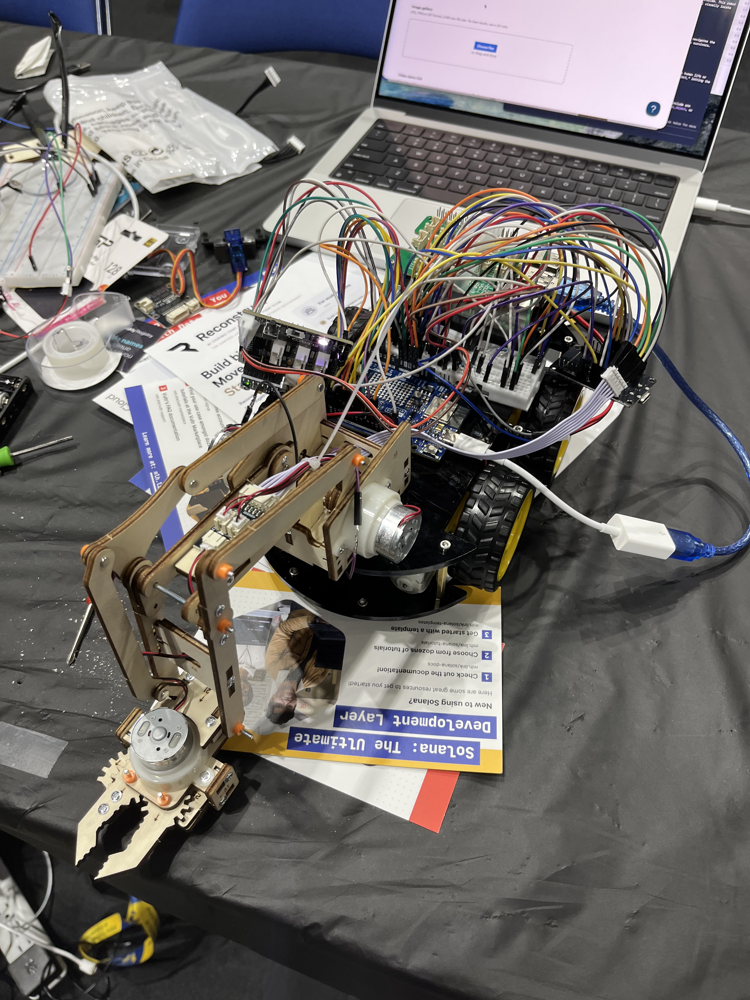

# HackDavis26



A hackathon build: an Elegoo Smart Robot Car that you can drive from your phone
or hand over to Google Gemini, which looks through an onboard camera and decides
where to go. It grew a wooden gripper arm and an ultrasonic sensor along the way.

## The build

A car chassis with drive motors, an Arduino UNO R4 WiFi, an ESP32 camera, a
breadboard, an ultrasonic distance sensor, a servo-driven gripper arm, and far
too many jumper wires, all powered off a battery pack and USB.

## How the workflow actually works

This is the honest version. The hard constraint is that a single WiFi radio
can't be on the camera's access point and the internet at the same time, and the
project ended up with two different ways of coping with that.

### Step by step (from a blank Pi to driving)

1. **Bake WiFi into the Pi image.** Using Raspberry Pi Imager, hard-code the WiFi
   SSID and password (and enable SSH / Raspberry Pi Connect) in the OS
   customization settings *before* flashing the SD card. That way the Pi
   auto-connects to WiFi on boot with no monitor, keyboard, or manual setup.
2. **Boot the Pi.** With the credentials baked in, it powers up and joins the WiFi
   on its own, completely headless.
3. **Wait for it to come online.** Watch for the device to show up at
   [connect.raspberrypi.com/devices](https://connect.raspberrypi.com/devices).
4. **Connect via Raspberry Pi Connect.** Once it appears, open a remote shell and
   screen to the Pi straight from the browser.
5. **Pull the code.** `git clone` this repo onto the Pi.
6. **Wire everything up.** Power on the ESP32 camera and the robot car, and plug
   the Arduino R4 into the Pi over USB. Wait for the Arduino to print
   `SYSTEM_READY` (it joins the camera's WiFi first, ~10 to 20 seconds).
7. **Run the scripts.** `source venv.sh`, then `python3 robot_pi.py`. It
   auto-detects the Arduino port, resets the board, waits for `SYSTEM_READY`, and
   serves the control panel on port 8080.
8. **Open the localhost web app** on the Pi (through Raspberry Pi Connect) and
   start sending commands: drive with the D-pad or WASD / arrow keys, hit
   **Capture** for a photo, or **Gemini** to give it a goal and let the model
   drive until you stop it.

The two subsystems behind those steps:

### Camera + AI path (Raspberry Pi)

`robot_pi.py` runs on a Raspberry Pi and is the "smart" path:

1. The Pi talks to the Arduino R4 over **USB serial**. It sends motor commands
   (`CMD:<DIR> <SPEED>`) and a capture trigger (`S`).
2. The Arduino R4 joins the **ESP32 camera's WiFi** on its own radio and pulls a
   JPEG, which it streams back to the Pi over serial with a magic-header
   protocol. This keeps the Pi's WiFi free for the internet.
3. The Pi hosts a web control panel on port 8080 and, in AI mode, sends each
   captured frame to **Gemini**, which replies with a direction.

Because the Pi ran headless, remote access was through **Raspberry Pi Connect**
([connect.raspberrypi.com](https://connect.raspberrypi.com)): once the Pi was
online I opened a shell and screen to it in the browser, ran the scripts, and
drove from the Pi's own localhost web app. The repo also includes a `cloudfared`
script that tunnels the web UI out through Cloudflare if you'd rather reach it
from another device. Convoluted, but it worked.

### Manual path (laptop, older)

`robot_web.py` and `robot_console.py` are the earlier approach: control the car
directly over **UDP** to its own `RobotCar` WiFi access point. The catch is that
the laptop has to join the car's AP to send packets, which drops your internet,
so these scripts use macOS WiFi-switching to hop back and forth between the robot
AP and home WiFi for each command. It's macOS-only and slow.

## Repository layout

```
davishacks/
├── robot_pi.py          # Pi: web UI + serial bridge + Gemini control (main path)
├── robot_web.py         # Laptop: browser UI, drives car over UDP (older)
├── robot_console.py     # Laptop: text console, drives car over UDP (older)
├── capture_image.py     # Standalone single-image capture over serial
├── cloudfared           # Script to expose the Pi web UI via a Cloudflare tunnel
├── venv.sh              # Dev setup: venv + deps + .env
├── requirements.txt
├── .env.example         # GEMINI_API_KEY
├── SmartRobotCarV4.0_V1_20230201working/  # Arduino R4 firmware (motors + camera)
└── Uno_R4_WiFi_Camera_Bridge/             # Alternate camera-only R4 firmware
```

## Running it

On the Pi:

```sh
source venv.sh          # venv + deps, and copies .env.example to .env
python3 robot_pi.py     # auto-detects the Arduino serial port, serves on :8080
```

Set `GEMINI_API_KEY` in `.env` for the AI mode. Open the printed URL (or the
Cloudflare tunnel URL from `cloudfared`) and drive with the on-screen D-pad or
WASD / arrow keys.

## Hardware

- Raspberry Pi (runs `robot_pi.py`)
- Arduino UNO R4 WiFi (motors + serial bridge to the Pi)
- Elegoo Smart Robot Car V4.0 chassis, motors, and ultrasonic sensor
- Elegoo ESP32 camera module (its own WiFi AP)
- Servo gripper arm, breadboard, jumper wires, battery pack

---

> Heads up: this branch is the original hackathon state. A cleaned-up, hardened
> version (auth on the web UI, safer emergency-stop, secrets removed from the
> tree, and the redundant/legacy pieces archived) lives on the **`fixes`**
> branch.
